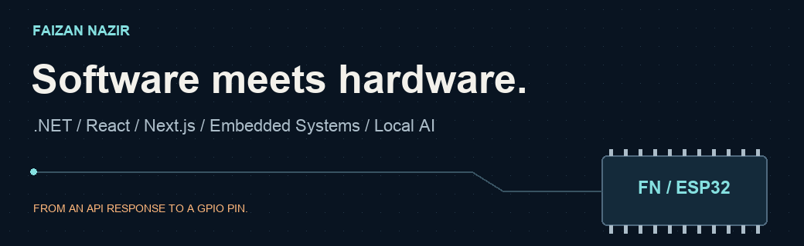
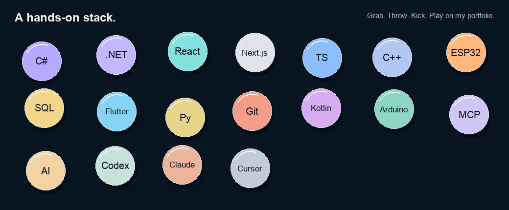

<picture>
  <source media="(prefers-reduced-motion: reduce)" srcset="assets/banner.png">
  
</picture>

# Hi, I'm Faizan Nazir

### Full-Stack Engineer · .NET · React · Next.js · Embedded Systems & IoT

Building reliable software that connects **applications, services, and hardware**.

**[Explore my interactive portfolio](https://faizannazir.github.io/faizannazir/)** · [LinkedIn](https://www.linkedin.com/in/faizannazir/) · [Email](mailto:faizannazir289@gmail.com)

## A little about me

I'm a software engineer based in **Rawalpindi, Pakistan**, working across C#/.NET backends, React/Next.js applications, and connected devices. I care about practical architecture, application performance, and making complex systems easier to work with.

- **At work:** Software Engineer at **GreyBeard Outsourcing**, since July 2024.
- **In open source:** local AI developer tools, ESP32 systems, and native Android experiences, MCP integrations, and AI tool building.
- **Across the stack:** REST APIs, SQL, authentication, Azure DevOps, firmware, and hardware–software integration.
- **Let's connect:** open-source collaboration, backend architecture, and embedded projects.

## My stack, with a little momentum

<a href="https://faizannazir.github.io/faizannazir/#playground">
  <picture>
    <source media="(prefers-reduced-motion: reduce)" srcset="assets/tech-balls.png">
    
  </picture>
</a>

**[Grab, throw, and kick the tech balls in the live playground](https://faizannazir.github.io/faizannazir/#playground)**

| Area                    | Technologies                                      |
| :---------------------- | :------------------------------------------------ |
| Backend                 | C#, .NET, ASP.NET Core / MVC, REST APIs, SQL      |
| Frontend                | React, Next.js, JavaScript, TypeScript, HTML, CSS |
| Embedded & IoT          | C / C++, ESP32, STM32, ESP-IDF, FreeRTOS, Arduino |
| Mobile & cross-platform | Flutter / Dart, Kotlin, Jetpack Compose           |
| Tools & delivery        | Azure DevOps, CI/CD, Git, Python, llama.cpp       |

**AI engineering:** MCP servers and integrations, custom AI tools, local coding agents, and model workflows.

**AI-assisted development:** Codex, Claude Code, and Cursor.

[View still artwork](assets/tech-balls.png) · [View still banner](assets/banner.png)

## Selected projects

### [LocalCoder](https://github.com/faizannazir/localcoder)

A local AI coding agent for your terminal and editor. Run GGUF models through llama.cpp, search and edit repositories, run checks, and undo changes. Hardware-aware routing loads planner, coder, and reviewer models one at a time.

`TypeScript` `Local AI` `Developer tools`

### [ESP32OS](https://github.com/faizannazir/Esp32OS)

An embedded operating environment built on ESP-IDF and FreeRTOS. A Linux-style shell brings task management, hardware diagnostics, networking, and an optional web dashboard to ESP32.

`C` `ESP-IDF` `FreeRTOS` `IoT`

### [Aether Launcher](https://github.com/faizannazir/Aether-Launcher)

A native Android launcher with a clean home screen, searchable app drawer, floating dock, customizable pages, and Android system integrations.

`Kotlin` `Jetpack Compose` `Android`

[All repositories](https://github.com/faizannazir?tab=repositories) · [Career, projects & playground](https://faizannazir.github.io/faizannazir/)

---

**From an API response to a GPIO pin. I like building the connection.**

[Start a conversation](mailto:faizannazir289@gmail.com) · [Connect on LinkedIn](https://www.linkedin.com/in/faizannazir/)

